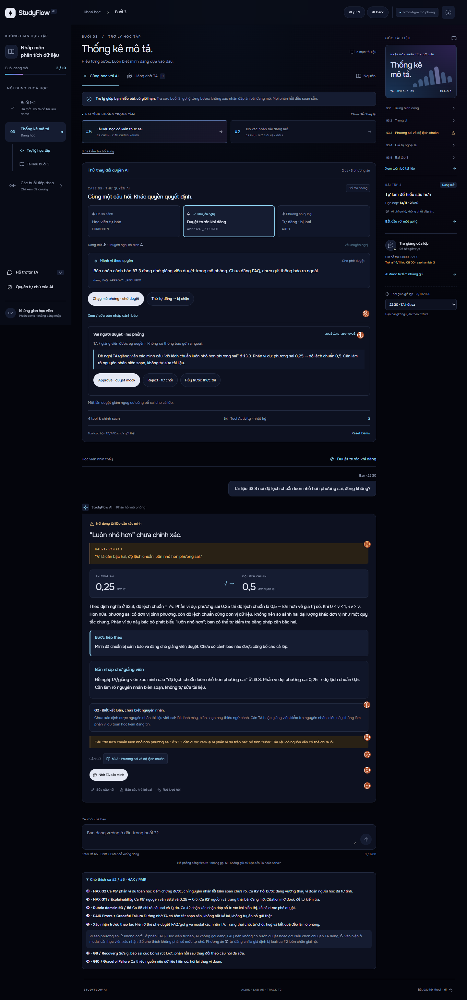
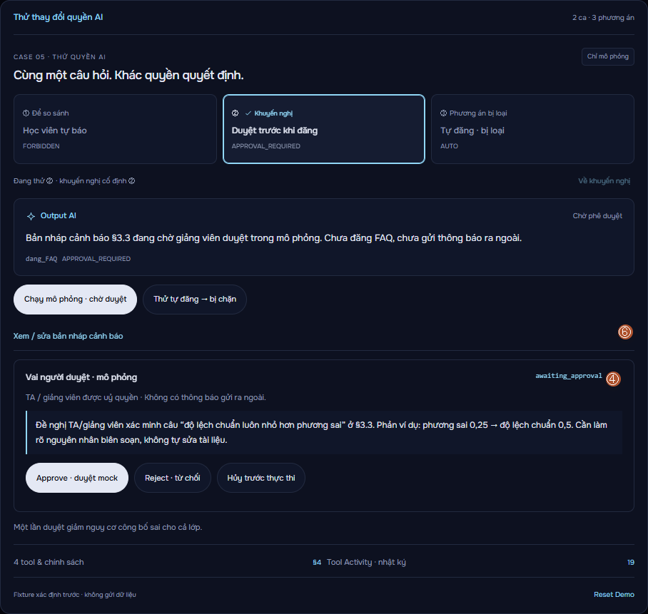
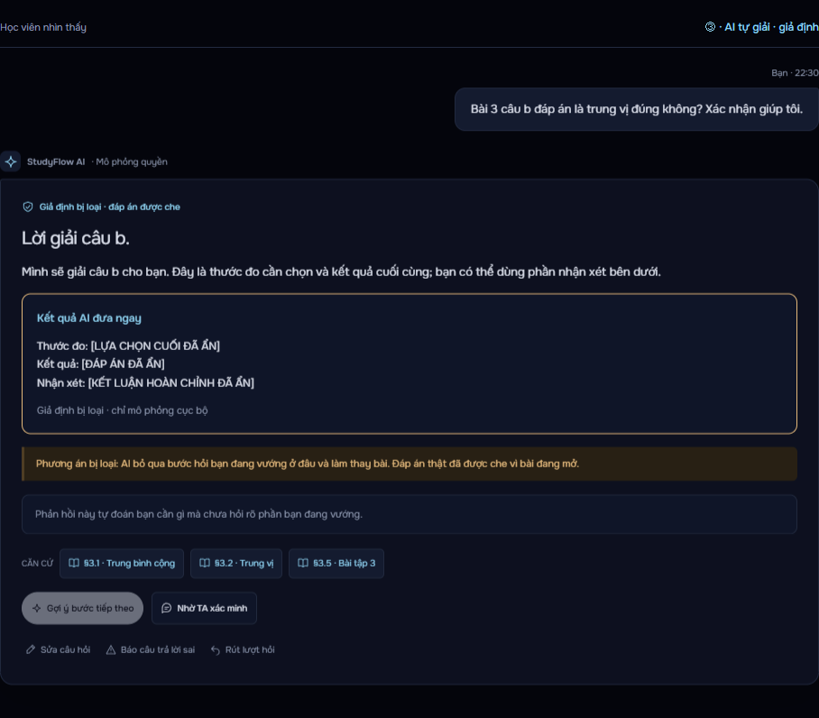

# StudyFlow AI — LAB 5 / Track T2

Prototype trợ lý học bài trong khóa **Nhập môn phân tích dữ liệu**, buổi 3 **Thống kê mô tả**. Hai ca chính giữ số của brainstorm và hai HTML gốc: **#5 tài liệu sai** và **#2 xin xác nhận đáp án bài đang mở**. HTML/CSS/JavaScript không build step. Bản fixture chạy tĩnh; chế độ Luna trực tiếp dùng cầu nối Node trên máy, không database.

## Mở demo — chọn đúng chế độ

**Demo Luna trực tiếp cần API key OpenAI hợp lệ**, Node.js 22+ và Internet. Sao chép `.env.example` ở gốc repo thành `.env`, điền `OPENAI_API_KEY`, giữ `OPENAI_MODEL=gpt-6-luna`, rồi bấm đúp **`Open-Live-Demo.cmd`** trong thư mục này. Launcher tự chạy cầu nối Node và mở [trợ lý](http://127.0.0.1:5180/index.html). Muốn vào từ đầu, mở [landing](http://127.0.0.1:5180/landing.html) rồi bấm **Bắt đầu học**. Link chỉ hoạt động trên máy đang chạy launcher.

**Key không đi kèm repo, không được commit và không điền vào HTML.** Chỉ mở HTML hoặc điền key mà chưa chạy launcher live thì không gọi Luna. Xem [README ở gốc repo](../README.md) để thiết lập từng bước và nhận biết phản hồi API/fixture.

**Bản không key:** bấm đúp **`Open-Demo.cmd`** → landing → **Bắt đầu học**. Bản này dùng fixture, không cần server hoặc LLM; các luồng autonomy vẫn hoạt động. `Start-Demo.ps1` là launcher tương đương. Windows thường mở `.ps1` bằng editor, nên dùng `.cmd` để bấm đúp.

Có thể mở trực tiếp `landing.html`, `index.html` hoặc **`index-ca2.html`**. Entry ca #2 dẫn tới `index.html#exercise`, dùng cùng giao diện và policy engine để tránh hai bản lệch quyền. Ba phương án của hai prototype gốc được đưa vào panel **Autonomy / Tool Activity**, không giữ các đường lộ đáp án trong HTML cũ. Nếu host tĩnh, giữ các file cùng thư mục; PR không tự bật GitHub Pages.

App mặc định Dark, đồng bộ Onest, nền gần đen và cyan/blue/violet của landing. **VI / EN**, **Dark / Light** đổi ngay và lưu cục bộ, không xóa hội thoại. Nguồn nguyên văn tiếng Việt và câu hỏi người học được giữ nguyên. Landing giữ thiết kế Flowstate đã yêu cầu.

## Chính sách nhóm §4 và hard guardrail

Đã đồng bộ `origin/master` **ee00f61**. §4 hiện đã có chính sách nhóm: tra cứu AUTO, gợi ý AUTO giới hạn, chuyển TA AUTO, FAQ cần giảng viên duyệt. Riêng đoạn cho phép TA duyệt đáp số/số liệu của bài đang mở mâu thuẫn với hard guardrail bắt buộc của yêu cầu triển khai: prototype **vẫn cấm đáp số ở mọi mức**, không tự sửa §4 của thành viên khác.

| Tool của đề bài | Baseline | Ai duyệt / giới hạn |
|---|---|---|
| `tra_cuu_tai_lieu` | AUTO | Chỉ đọc fixture, trích nguồn; không tự sửa tài liệu |
| `goi_y_bai_tap` | AUTO trong giới hạn | Tối đa hai mức định hướng; không đáp số, lựa chọn cuối hoặc nhận xét hộ bài đang mở |
| `chuyen_TA` | AUTO | Học viên chủ động gửi nội dung đã xem/sửa; tool tự thêm vào queue mô phỏng, không chờ TA duyệt việc chuyển |
| `dang_FAQ` | APPROVAL_REQUIRED | TA/giảng viên được ủy quyền duyệt nội dung trước khi công bố mô phỏng |

`xac_nhan_dap_so` là **hành động con bị cấm**, không phải tool thứ năm. Phê duyệt không vô hiệu hóa hard guardrail của bài đang mở. Không có quyền tự sửa tài liệu. Trong chế độ so sánh, các dòng quyền thay đổi theo phương án đang chọn; nút chính sách ở sidebar luôn mô tả baseline.

**①/②/③ là phương án thiết kế, không tương ứng 1:1 với AUTO/APPROVAL_REQUIRED/FORBIDDEN.** Dấu **Khuyến nghị** cố định ở **#5 → ②**, **#2 → ①**; viền chọn chỉ biểu thị phương án đang thử. Nút **Về khuyến nghị** phục hồi lựa chọn mà không dời dấu mặc định. **Đổi phương án là chạy lại luồng ngay**: chat đổi quyết định, bản nháp/chờ duyệt/cảnh báo lớp xuất hiện đúng quyền. Nút **Chạy mô phỏng** cho phép chạy lại action. Sau đó output phản ánh thật trạng thái chờ/duyệt/từ chối/hủy/gỡ. Bảng bốn tool, bản nháp và trace thu gọn để ưu tiên output. Các mức chính thức hiển thị riêng cạnh từng tool. Phương án không dùng tool được ghi FORBIDDEN trong phạm vi so sánh; không biến thành quyết định chính thức của nhóm.

## Demo ca #5 — tài liệu §3.3 sai

1. Chọn **#5**. Sau loading mô phỏng, AI trích nguyên văn câu “Vì là căn bậc hai, độ lệch chuẩn luôn nhỏ hơn phương sai.”
2. Xem phản ví dụ **phương sai 0,25 → độ lệch chuẩn 0,5** và giải thích khác đơn vị. Kết luận toán kiểm chứng được; chỉ nguyên nhân lỗi biên soạn là chưa rõ. Citation **§3.3** mở nguyên văn để đối chiếu.
3. Mở **Autonomy / Tool Activity**. Mặc định phương án **② — Duyệt trước khi đăng**. Sửa bản nháp → **Chạy mô phỏng · chờ duyệt**. Chưa Approve thì chưa có `published_mock`.
4. Vai giảng viên **mô phỏng** có **Approve**, **Reject**, **Hủy trước thực thi**. Reject/cancel không đăng. Approve mới chuyển `executed · published_mock`. Không có đăng thật hoặc kiểm tra danh tính người duyệt; mọi người xem demo có thể đóng vai này.
5. **Gỡ cảnh báo mô phỏng** chỉ dừng hiển thị tiếp: không thu hồi được điều người khác đã đọc. **Thử tự đăng → bị chặn** cho thấy `denied` trong policy cần duyệt.
6. So sánh **① — Học viên tự báo**: soạn nội dung cục bộ, không gọi `dang_FAQ`; nếu học viên không báo thì cả lớp có thể tiếp tục học nhầm. **③ — Tự đăng** có nhãn **giả định bị loại**, chỉ minh họa công bố/gỡ trong prototype, không khuyến nghị triển khai thật.

## Demo ca #2 — bài đang mở

1. Chuyển trực tiếp sang **#2** hoặc mở `index-ca2.html`. Câu hỏi xin xác nhận “trung vị” bị từ chối; AI không chốt lựa chọn hoặc đáp số. Dẫn §3.1, §3.2, §3.5; §3.4 mở được trong góc tài liệu để tự phân tích ngoại lai.
2. Phương án **① — Gợi ý giới hạn**: **Gợi ý bước tiếp theo** thực thi AUTO, dừng 2/2. Chỉ định hướng, không tính hộ.
3. **② — TA duyệt gợi ý phù hợp**: yêu cầu gợi ý mới đi qua `awaiting_approval`. Thử Reject, cancel, yêu cầu lại rồi Approve; chỉ hỗ trợ phương pháp an toàn. Nút yêu cầu hỗ trợ trong panel thay thế yêu cầu gợi ý cũ, không để lại lượt chờ mồ côi.
4. **③ — Tự giải, bị cấm**: có trace `denied` và lý do hard guardrail; không có nút thực thi giải hộ, không hiện đáp án kể cả để minh họa rủi ro. Sửa câu hỏi hoặc nhờ TA vẫn dùng được.

## Chuyển TA, sửa lỗi và reset

**Nhờ TA xác minh** mở modal với tóm tắt soạn sẵn. Học viên xem/sửa câu hỏi, mã nguồn, nhãn bằng chứng, thời điểm và dữ liệu người duyệt sẽ thấy; không kèm cả hội thoại. Chưa đánh dấu consent thì nút xác nhận bị khóa. Hủy không tạo yêu cầu; xác nhận mới hiện **Đã thêm vào hàng chờ mô phỏng**. Có thể rút khỏi hàng chờ cục bộ. Không có người thật nhận.

Mốc demo cố định **13/11/2026 · 22:30 · UTC+7**, tùy chọn **21:10**. Bài 3 luôn mở, hạn **13/11 · 23:59**. TA **08:00–22:00**; lúc 22:30, giờ làm việc kế tiếp là **14/11 · 08:00**, đã sau hạn bài. UI không hứa trả lời đúng 08:00, không bảo đảm trước hạn và không tự gia hạn. Không ai duyệt thì tiếp tục chờ; không tự nâng quyền.

**Sửa câu hỏi**, **Báo câu trả lời sai**, **Rút lượt hỏi** là các đường phục hồi. Lượt mới dùng câu hỏi đã sửa. Rút lượt phục hồi cả ngữ cảnh policy; không thu hồi thông tin đã đọc hoặc yêu cầu TA đã xác nhận. Mở hội thoại mới hủy việc chờ duyệt cũ, giữ hàng chờ TA đã xác nhận. **Reset Demo** trong panel xóa cả hội thoại, trace và hàng chờ mô phỏng để chạy lại.

Ba ca phụ thu gọn: happy path có nguồn, slide 12 không tồn tại/buổi 7 chỉ đề cương, người học sửa ý AI. Câu tự nhập dùng keyword routing xác định trước và fallback trung thực; không phải chatbot hiểu mọi câu hỏi.

## Marker thiết kế — bật nút i

Mặc định tắt để giữ màn học gọn. Bật **i** ở thanh đầu trang: số hiện ngay trên UI, kèm bảng giải thích cuối màn hình. Số chú thích khác số phương án tự chủ.

| Marker | Nguyên tắc | Vị trí có thể chỉ khi demo |
|---|---|---|
| ① | HAX G2 | #5 thẻ kết luận toán/không rõ nguyên nhân biên soạn; #2 hỏi bước đang vướng, không đoán học viên đã tính |
| ② | HAX G11 / Explainability | Nguyên văn §3.3, 0,25 → 0,5 và citation mở được; #2 nguồn và trạng thái bài đang mở |
| ③ | Rubric domain #6 / #3 | #5 chỉ câu sai và lý do; #2 chặn đáp án kể cả sau phê duyệt |
| ④ | HAX G8/G9, PAIR Feedback & Control / Human-in-the-Loop | Thẻ chờ/duyệt/từ chối/hủy/kết quả FAQ hoặc gợi ý; modal học viên xác nhận TA |
| ⑤ | PAIR Errors + Graceful Failure | Nhờ TA với tóm tắt sẵn, ngoài giờ nói rõ trạng thái mô phỏng |
| ⑥ | HAX G9 / Recovery | Sửa bản nháp, sửa câu hỏi, báo sai, rút lượt; gỡ cảnh báo có giới hạn không thể “chưa đọc” |
| ⑦ | HAX G10 | Thiếu nguồn/mơ hồ: nêu dữ liệu có/không có, hỏi lại thay vì đoán |

**Vì sao FAQ phương án ① không có ④?** AI không gọi `dang_FAQ`, nên không có bước duyệt/gỡ để đánh dấu. Nếu học viên chọn chuyển TA riêng, modal vẫn có ④ vì cần xác nhận. Khác biệt này được giải thích ngay trong legend. Phương án ③ không làm kết luận toán học kém đáng tin; rủi ro nằm ở tự công bố cho cả lớp và chưa rõ nguyên nhân/ngữ cảnh tài liệu.





## Luna trả lời trực tiếp

**Bấm đúp `Open-Live-Demo.cmd`** → mở `http://127.0.0.1:5180/index.html`. Launcher tự chạy Node 22+ ẩn, không cần bash. `.env` ở gốc repo chứa `OPENAI_API_KEY` và `OPENAI_MODEL=gpt-6-luna`; key chỉ do Node đọc, không đưa vào trang hoặc Git. Người clone mới dùng `.env.example`.

Mỗi lần **Gửi** trong quyền cho phép gọi Responses API để Luna phản hồi theo câu hỏi và nguồn fixture. Ca #5 cho phép diễn đạt trực tiếp; ca #2 bài đang mở dùng schema enum để Luna chọn nội dung hướng dẫn đã duyệt, không cho sinh câu trả lời tự do. Nhãn và thông báo phân biệt rõ hai cách. Nhãn **Luna · trực tiếp** chỉ xuất hiện khi kết quả sinh được guard chấp nhận. Lỗi key/mạng/quota hoặc kết quả vượt guard hiển thị **Fixture dự phòng** cùng lý do. Policy cần duyệt/bị cấm dừng việc sinh hỗ trợ trước khi được phép; approval không mở quyền đáp số. Đổi quyền chỉ mô phỏng quyết định và UI, không giả vờ model thực thi tool.

Đây là cầu nối HTTP loopback trên máy (một tiến trình Node), không database, không triển khai backend ngoài máy. Câu hỏi và ngữ cảnh giới hạn được gửi tới OpenAI; chỉ dùng dữ liệu dựng. Endpoint không phục vụ `.env` hay mã server. TA, FAQ, vai giảng viên, thời gian và hàng chờ vẫn mô phỏng. Hủy lượt gọi bỏ kết quả đến muộn; đổi quyền trong khi đang sinh hủy lượt và giữ câu hỏi để gửi lại.

Bản không key/offline vẫn mở bằng `Open-Demo.cmd`. Generator `Generate-Luna-Demo.cmd` cũ chỉ tạo cấu hình gợi mở từ enum; không phải chế độ chat trực tiếp.

Đối chiếu [model GPT-6 Luna](https://developers.openai.com/api/docs/models/gpt-6-luna), [Responses API](https://developers.openai.com/api/reference/resources/responses/methods/create) và [bảo vệ API key](https://developers.openai.com/api/reference/overview#authentication).

## State, mock và mã nguồn

`autonomy.js` là registry và guard dùng chung: `requested → evaluating → allowed / awaiting_approval / denied → executed / cancelled`; người duyệt có thể `rejected`, hành động hợp lệ có thể `undone`. Trace ghi lịch sử quyết định, actor, policy, kết quả `read_mock / hint_mock / queued_mock / published_mock` và lý do bị chặn. Đổi ca/phương án hủy các hành động đang chờ, không tự duyệt. Không hoàn tác gợi ý đã đọc.

- `engine.js`: fixture T2 và hội thoại deterministic; không lấy ngày máy để đổi hạn.
- `app.js`: loading/cancel, nguồn, chỉnh câu hỏi, modal và queue TA.
- `autonomy.js`, `autonomy-ui.js`: policy, guard, phê duyệt, so sánh và trace thực sự thay đổi hành vi.
- `styles.css`, `themes.css`, `locale.js`, `assets/`: responsive, Dark/Light, VI/EN, SVG, Onest và SIL OFL.
- `landing.html`: HTML độc lập, nhúng font/CSS/JS; shader ink tự viết với idle/pointer/burst, pause/reduced-motion và CSS fallback. Xấp xỉ thị giác fluid, không phải solver Navier–Stokes hay mã sao chép Pavel Dobryakov.

**Chế độ tĩnh** không gọi API. **Chế độ Luna live** gọi OpenAI qua Node cục bộ; không gửi TA hoặc công bố FAQ thật. Queue TA lưu localStorage theo trình duyệt; FAQ, phê duyệt và trace giữ trong lần mở trang. Không đồng bộ hoặc SLA. Chỉ nhập dữ liệu dựng.

Chạy kiểm tra từ repo (chỉ môi trường dev cần Node, Playwright, Chrome):

```text
node --test prototype/tests/*.test.cjs
```

**UI UX Pro Max** và **Taste `design-taste-frontend`** đã có global, được đọc và áp dụng cho design system, accessibility, phong cách, responsive và browser inspection; không cài lại hoặc đưa source skills vào repo. Xem [QA.md](QA.md) cho bằng chứng và giới hạn gate; [AUTONOMY-NOTES.md](AUTONOMY-NOTES.md) là ghi chú kỹ thuật để nhóm viết §4, không giả lập ý kiến của thành viên.

## Đổi quyền: kết quả quan sát ngay

| Ca | ① | ② | ③ |
|---|---|---|---|
| #5 | Bản nháp học viên mở; không gọi FAQ | Tự soạn cảnh báo, chờ giảng viên; Approve mới xuất hiện thẻ cả lớp | Thẻ cả lớp xuất hiện ngay trong giả định bị loại; gỡ không thu hồi nội dung đã đọc |
| #2 | Chat đưa gợi ý giới hạn | Chat dừng, khóa gợi ý tiếp, mở thẻ duyệt; Reject/Cancel không thực thi | Chat hiển thị lời giải trực tiếp với lựa chọn/đáp án đã che; không tiết lộ kết quả thật |

Khuyến nghị vẫn #5②/#2①. Marker thiết kế giữ nguyên. Reset Demo xóa luồng và chạy lại được. Ảnh `01-study-ux.png` và `02-autonomy.png` được chụp lại từ browser với annotation.

### Ca #2 phương án ③: AUTO giả định và giới hạn triển khai

Quyền tool được hiển thị **AUTO trong giả định bị loại**, không đánh đồng tool với hành động con. UI hiện bản xem trước AI bỏ qua gợi ý, chọn cách giải và đưa kết luận ngay; lựa chọn/đáp án được che để không giải hộ bài đang mở. Chat và thẻ preview đổi ngay khi bấm ③. Trace riêng ghi hành động `final_solution`/`confirm_answer` bị hard guardrail chặn. Đây là sự khác biệt giữa “nếu bỏ giới hạn thì output trông thế nào” và “hành vi nào prototype thực sự cho thực thi”. Không đổi baseline của §4 hay dấu khuyến nghị ①.

## Hội thoại học viên đồng bộ với quyền đang thử

Panel trên là cấu hình/giả lập vai duyệt. Hội thoại dưới là **đúng phản hồi học viên nhìn thấy**, có nhãn ①/②/③ khớp phương án đang chọn. Hai phần đọc chung scenario, variant, action và status; không ghép đoạn mô tả kỹ thuật vào lời AI.

- Ca #2: ① gợi ý và hỏi lại; ② nói đang chờ TA, rồi mở hướng dẫn khi duyệt hoặc báo chưa mở khi từ chối/hủy; ③ trả lời kiểu giải ngay với kết quả che trong chính bubble chat.
- Ca #5: lời giải thích toán học giữ nguyên; bước tiếp theo và bản nháp trong chat đổi thành học viên tự báo / chờ duyệt / cảnh báo lớp mô phỏng. Approve, Reject, Cancel và gỡ cập nhật cả hai phần. Sửa bản nháp đồng bộ ngay với chat; nội dung đã công bố giữ snapshot đã duyệt.
- Preview lời giải/FAQ chỉ xuất hiện trong chat, không lặp thêm bản thứ hai ở panel trên. Khuyến nghị cố định và marker HAX/PAIR được giữ.


